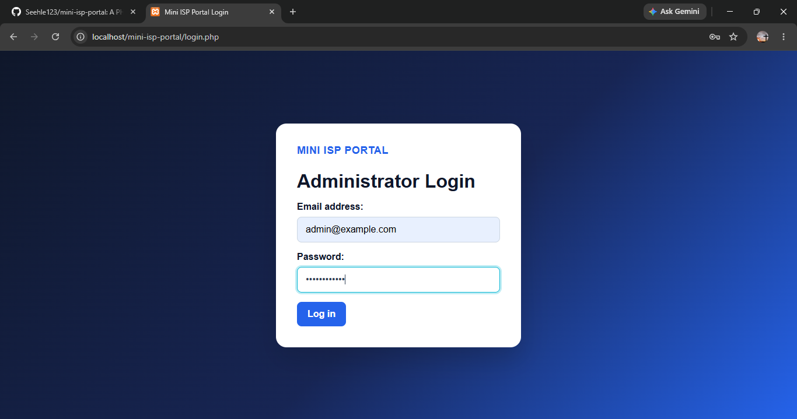
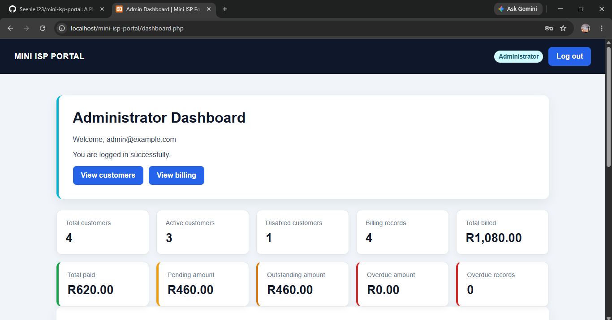
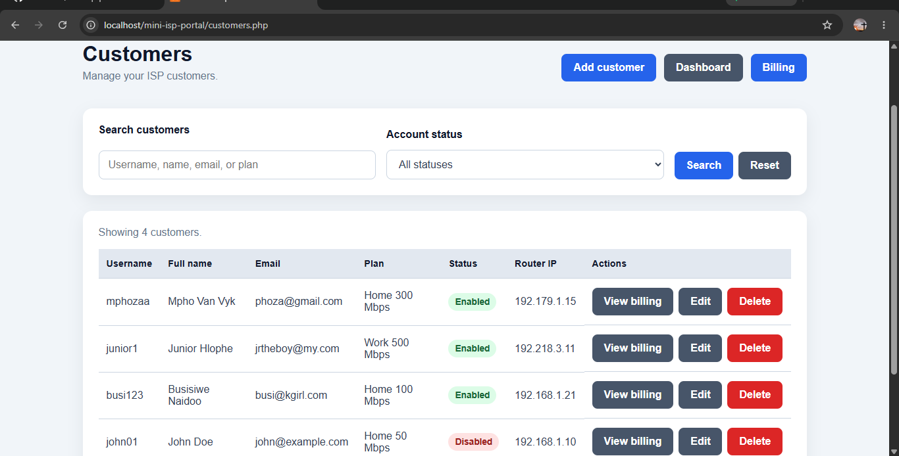
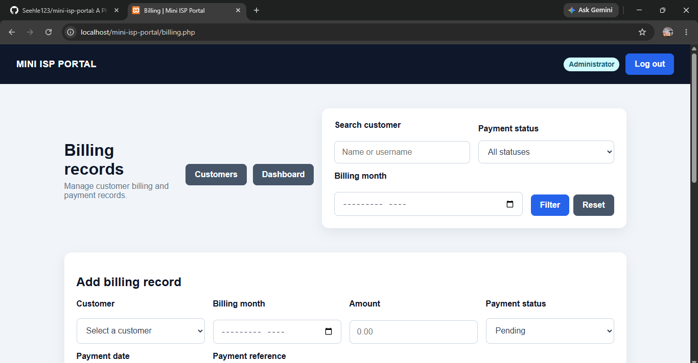
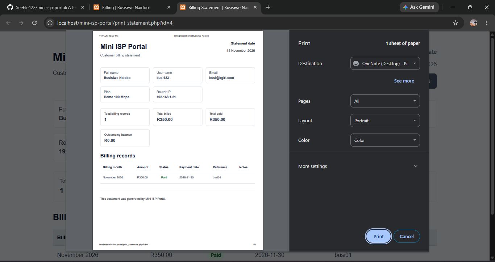

# Mini ISP Portal

A PHP and MySQL customer and billing management portal created as a programming portfolio project.

## Features

- User login and logout
- Customer management
- Add, edit, and delete customers
- Billing management
- Customer billing history
- Printable customer statements
- Database-backed PHP application

## Technologies

- PHP
- MySQL
- HTML
- CSS
- GitHub

## Screenshots

### Login page

### Dashboard

### Customer management

### Billing page

### Printable statement

## Running the project locally

1. Install XAMPP, Laragon, or another local PHP and MySQL environment.
2. Copy the project into the local server folder.
3. Create a local MySQL database.
4. Copy `db.example.php` to `db.php`.
5. Add your local database credentials to `db.php`.
6. Import or create the required database tables.
7. Start Apache and MySQL.
8. Open the project through the local server.

## Security note

The real database configuration file is excluded from the repository. Only placeholder database settings are included. The repository does not contain real passwords, private credentials, or real customer information.
